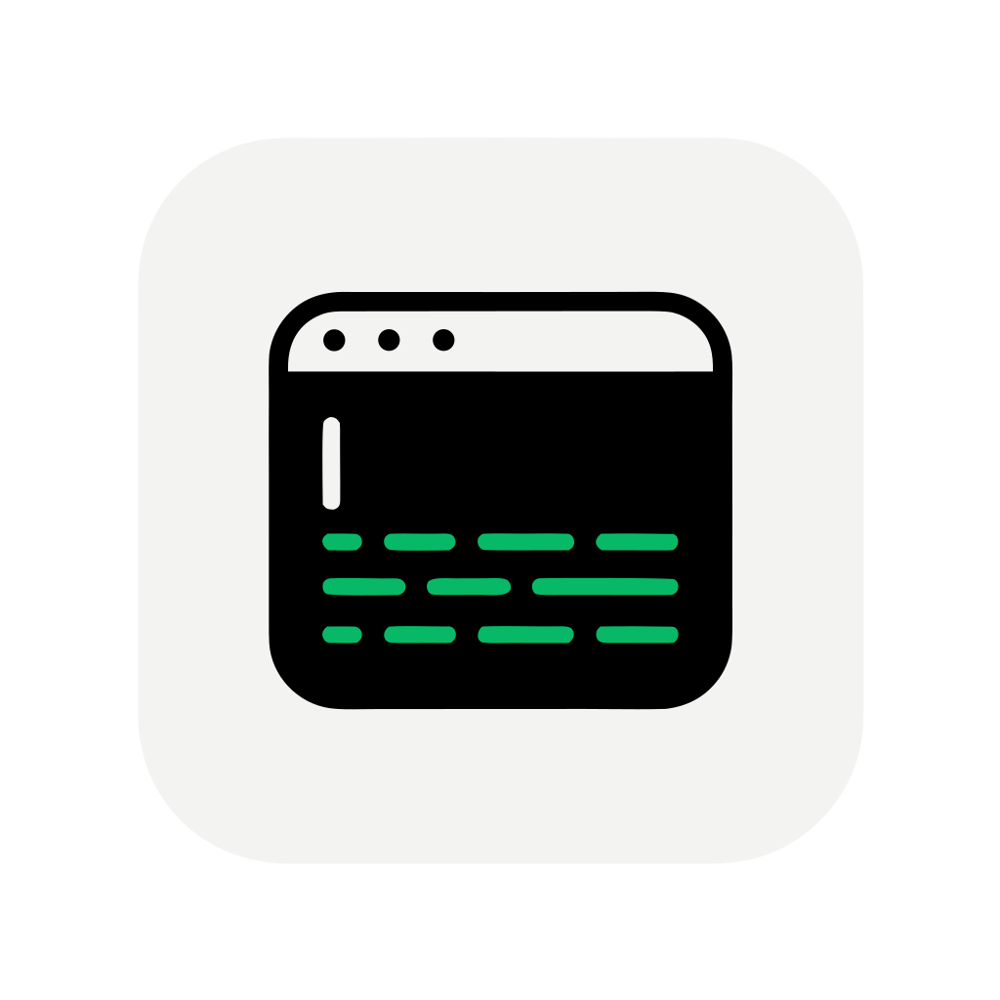

# Serial Monitor

面向 macOS 的单窗口串口监视与调试工具。当前开发版本支持发现串口、配置通信参数、连接/断开、接收原始字节、以 ASCII 或 HEX 查看记录，以及手动发送数据。

> 工程部署目标为 **macOS 14.0**，以 macOS 26+ 的 Liquid Glass 为优先体验、低版本回退到系统 Material。当前已在 macOS 27 本机与 macOS 15 CI 验证；**macOS 14 的 App 运行时尚未实机验证**，涉及编译需 macOS 26+ SDK（见下）。

## 当前状态

已完成的开发能力：

- 串口端口发现与完整通信参数配置（波特率、数据位、校验、停止位、流控制）
- 单一活跃会话的连接、取消连接、断开、接收与 FIFO 手动发送
- ASCII / HEX 记录显示、时间戳、自动跟随、暂停显示和清空记录
- 编辑器重复发送与预设循环发送（单一全局任务、有限次数或无限循环）
- 本机持久化的预设 CRUD、单次发送与循环发送
- 手动启停的 NDJSON 日志、设置窗口、菜单命令与快捷键
- 中文 SwiftUI 主工作区，以及 macOS 原生工具栏和检查器布局

发布脚本（归档/导出/公证/验证）已就绪，但 Developer ID 签名与公证受凭据限制、真实设备兼容性验证受硬件限制，均尚未执行；详见 [发布检查清单](Docs/ReleaseChecklist.md)。

## 下载安装（Release）

在仓库 **Releases** 页面下载 `SerialMonitor-<版本>.dmg`（或 `.zip`），拖入“应用程序”即可，支持 Apple Silicon 与 Intel，最低 macOS 14。

发布包由 `.github/workflows/release.yml` 在推送 `v*` 标签时自动构建并上传。当前为 **ad-hoc 签名、未公证**，首次打开需放行 Gatekeeper：

- 访达中右键 App → **打开** → 仍要打开；或
- 终端执行 `xattr -dr com.apple.quarantine /Applications/SerialMonitor.app`

要做到下载后无提示直接运行，需要 Developer ID 签名与公证凭据（见下方“发布”）。

## 环境要求

- 运行最低版本 macOS 14.0；当前已在 macOS 27 本机与 macOS 15 CI 验证，**macOS 14 运行时未验证**
- 编译需要包含 macOS 26 SDK 的完整 Xcode 26+（Liquid Glass API 需在编译期存在；仅安装 Command Line Tools 不足以运行和测试此 App）
- 已选择完整 Xcode 工具链，例如：`xcode-select -p` 应指向 `/Applications/Xcode.app/Contents/Developer`
- 当前已在 Apple Silicon 开发机上验证

项目使用仓库内的本地 Swift Package `Packages/SerialCore`；打开工程或执行构建时，Xcode 会自动解析它，不需要安装 Homebrew 或第三方串口库。

## 用 Xcode 运行

1. 在终端运行 `open SerialMonitor.xcodeproj`，或在 Finder 中打开工程。
2. 在 Xcode 顶部选择 `SerialMonitor` scheme 和 **My Mac** 运行目标。
3. 点击运行按钮（或按 `⌘R`）即可进行本地试用。只有要验证已签名沙盒 App 对真实串口的访问时，才需要在 **Signing & Capabilities** 配置开发签名身份。
4. 启动后点击“刷新”，选择目标串口和波特率；如有需要，通过“参数”设置数据位、校验、停止位和流控制。
5. 点击“连接”。连接成功后，在下方发送区选择 ASCII 或 HEX、行结束符并输入数据，再点击“发送”（或按 `⌘↩`）。

未连接时，发送按钮会保持禁用。HEX 模式只接受合法的十六进制字节；校验错误会显示在输入框下方且不会清除已输入内容。

### P3 功能试用位置

- 在发送区设置内容、格式和行结束符后，使用“重复发送”启动/停止循环；可选 10 ms 以上的间隔，以及有限次数或无限循环。断连或发送失败会自动停止。
- 通过工具栏的检查器按钮打开右侧“预设”，可新增、编辑、删除、单次发送或循环发送预设；预设会保存在本机。
- 使用工具栏的“开始记录”选择目录后开始写入 NDJSON 日志，再次点击可停止；日志文件名由“设置”（`⌘,`）中的目录和前缀决定。
- “设置”（`⌘,`）还可调整默认通信参数、显示格式、时间戳、自动跟随与预设面板状态。菜单中提供刷新、连接、发送、暂停、清空和日志的等价命令及快捷键。

本地试用不包含真实 USB-UART、蓝牙对端或物理热拔出验证；常规启动使用系统 POSIX 串口实现，测试时才会启用内置的确定性场景替身。

## 命令行运行

无需开发签名即可构建并打开本地 Debug App：

```zsh
derived_data="${TMPDIR:-/tmp}/SerialMonitor-DerivedData"

xcodebuild \
  -project SerialMonitor.xcodeproj \
  -scheme SerialMonitor \
  -configuration Debug \
  -destination 'platform=macOS,arch=arm64' \
  ONLY_ACTIVE_ARCH=YES \
  CODE_SIGNING_ALLOWED=NO \
  -derivedDataPath "$derived_data" \
  build

open "$derived_data/Build/Products/Debug/SerialMonitor.app"
```

退出 App 后可再次执行上述命令；构建产物位于临时目录，不会写入仓库。若系统阻止打开，请改用上面的 Xcode 运行方式。

## 命令行构建与测试

先运行开发环境检查：

```zsh
zsh Scripts/verify-development-environment.sh
```

以下命令可进行无签名 Debug 构建，适用于本地工程、Swift 6 并发和依赖解析检查：

```zsh
xcodebuild \
  -project SerialMonitor.xcodeproj \
  -scheme SerialMonitor \
  -configuration Debug \
  -destination 'platform=macOS,arch=arm64' \
  ONLY_ACTIVE_ARCH=YES \
  CODE_SIGNING_ALLOWED=NO \
  build
```

日常回归请使用自动化脚本。它按阶段运行 SerialCore、App Unit、PTY 集成与 UI 测试，使用共享的 `TestArtifacts/DerivedData`，并把各阶段日志、`.xcresult`、覆盖率报告与 `summary.json`/`summary.md` 写入 gitignore 的 `TestArtifacts/<时间戳>/`：

```zsh
zsh Scripts/run-automated-tests.zsh            # 默认：SerialCore + 单元/PTY + UI
zsh Scripts/run-automated-tests.zsh --quick    # 仅 SerialCore + 单元/PTY
zsh Scripts/run-automated-tests.zsh --ui-only  # 仅 UI
zsh Scripts/run-automated-tests.zsh --stress   # 追加 30 分钟 Py PTY 压测
```

脚本不访问真实串口；PTY、`Scripts/pty_stress.py` 与内置 UI 场景替身是日常自动化的串口替身。压测默认跳过，需 `--stress` 显式启用；`--xctest-stress` 可运行进程内 `PTYStressTests`。覆盖率仅记录，不设百分比门禁。矩阵见 [自动化测试矩阵](Docs/AutomatedTestMatrix.md)，界面检查见 [UI 测试与界面检查清单](Docs/UITestChecklist.md)。

也可在已配置开发签名的环境中直接运行 Xcode 测试：

```zsh
xcodebuild \
  -project SerialMonitor.xcodeproj \
  -scheme SerialMonitor \
  -destination 'platform=macOS' \
  ONLY_ACTIVE_ARCH=YES \
  test
```

该 scheme 同时包含 Unit Tests 和 UI Tests。直接运行的 UI 测试需要可启动测试 Runner 的有效开发签名；无开发签名时优先使用上述脚本，它会为 UI Runner 使用 ad-hoc 签名。

## 持续集成

`.github/workflows/regression.yml` 在 push 与 PR 时运行：

- `serialcore`（`macos-14` 与 `macos-15`）：`swift test --package-path Packages/SerialCore`
- `app`（`macos-15` + 最新 Xcode）：`zsh Scripts/run-automated-tests.zsh --all`，并把阶段摘要与 `TestArtifacts/` 作为构建产物上传

CI 不访问真实串口，也不做签名/公证；它覆盖 macOS 15 上的完整单元/PTY 与 UI 回归（含 Material 回退分支）。

## 常见问题

### 刷新后没有可选串口

确认 USB 转串口设备已连接、驱动已被 macOS 识别，并再次点击“刷新”。开发机内置的 Bluetooth/debug-console 端口不等同于已验证的 USB-UART 设备。

### 连接或访问串口失败

确认端口未被其他程序占用，通信参数与设备端一致。若在签名 App 中测试，请确认 App Sandbox 的串口设备权限已启用；项目 entitlement 已声明 `com.apple.security.device.serial`。

### UI 测试 Runner 无法打开或提示已损坏

通常是缺少或不匹配的开发签名。请在 Xcode 的 **Settings → Accounts** 登录开发账号，并为 App 和测试 target 选择同一有效 Team，然后重新构建测试。

## 硬件验证边界

当前串口实现以系统 POSIX/termios 和 IOKit 为基线，但尚未完成 CH340、CP210x、FTDI、CDC-ACM 的实机回环、热拔出、占用和沙盒测试。因此项目尚不宣称支持或认证任何特定 USB-UART 芯片。

接入设备与 TX-RX 跳线后，可运行硬件冒烟（不进入 CI）：

```zsh
bash Scripts/hardware-smoke.sh --port /dev/cu.<device> --wait-unplug 20
```

它会验证打开/配置、回环收发与占用错误，结果回填 [真实设备测试矩阵](Docs/RealDeviceTestMatrix.md)。

详细的环境配置、验证命令与限制见 [开发环境说明](Docs/DevelopmentEnvironment.md)，设备验证进度见 [串口兼容性矩阵](Docs/SerialCompatibilityMatrix.md) 与 [真实设备测试矩阵](Docs/RealDeviceTestMatrix.md)，依赖决策见 [依赖登记](Docs/Dependencies.md)，性能见 [性能报告](Docs/PerformanceReport.md)，发布见 [发布检查清单](Docs/ReleaseChecklist.md) 与 [依赖与许可证](Docs/Licenses.md)。

## 发布（受限）

发布脚本已就绪，但缺少 Developer ID 与公证凭据、真实设备，尚不可执行签名/公证：

```zsh
bash Scripts/build_release.sh --smoke                    # 无签名 Release 构建冒烟
DEVELOPMENT_TEAM=<team> bash Scripts/build_release.sh    # 归档并导出
NOTARY_PROFILE=<profile> bash Scripts/notarize.sh <app>  # 提交/等待/staple
bash Scripts/verify_release.sh <app>                     # 验签、entitlement、Gatekeeper、公证与包内无用户数据
```

凭据只通过本机钥匙串/环境变量提供，不写入仓库。
