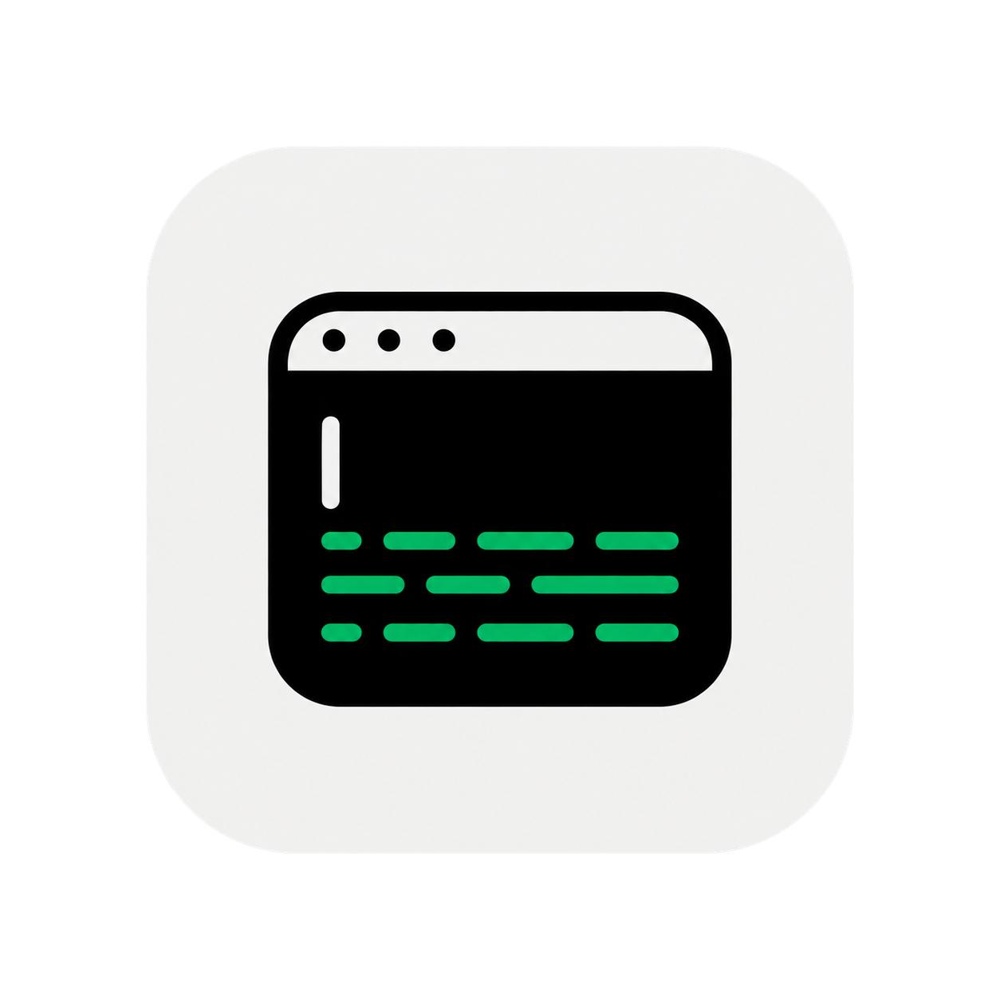
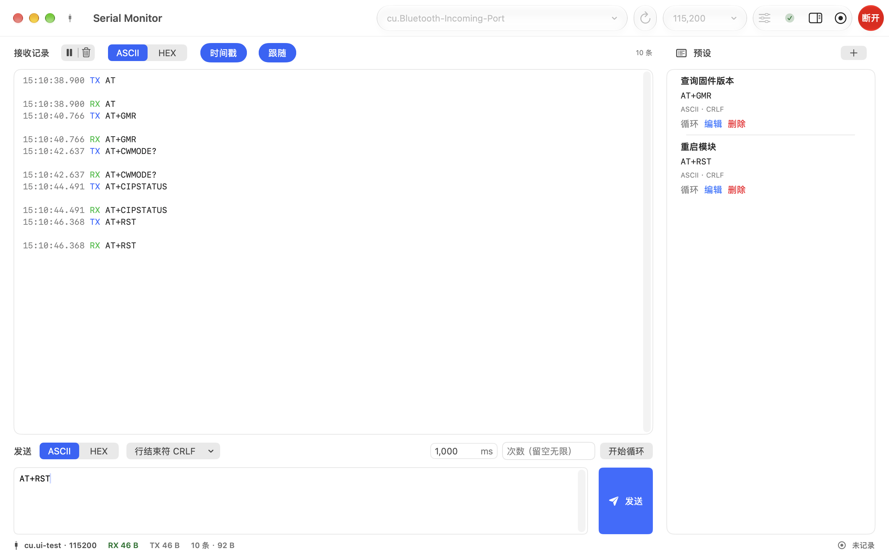
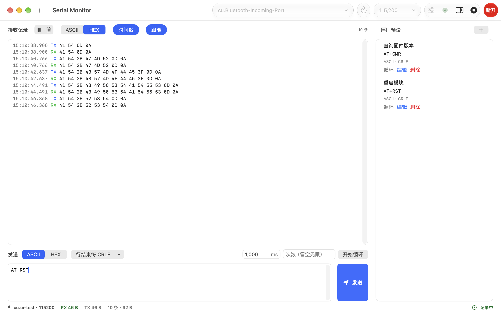
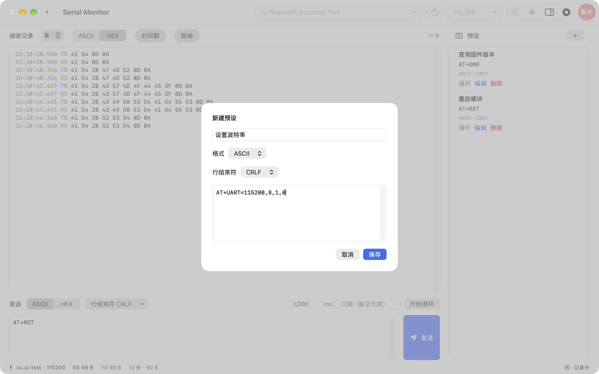
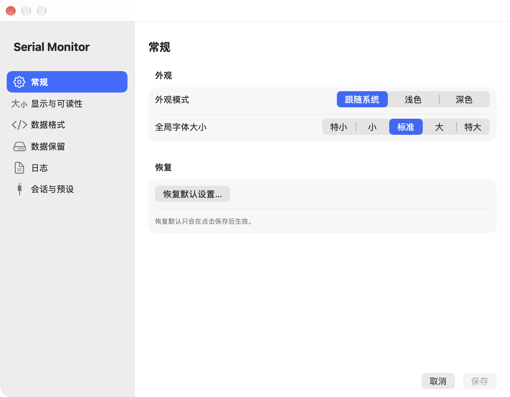

# Serial Monitor

[](https://github.com/Sher146/Serial_Debugger/actions/workflows/regression.yml)
[](https://github.com/Sher146/Serial_Debugger/releases/latest)
[](#环境要求)

面向 macOS 的单窗口串口监视与调试工具，界面为简体中文。连接串口后即可实时查看收发数据：用 ASCII 或 HEX 阅读、按时间戳定位问题、以手动/循环发送和预设完成日常调试，并把整段会话写入 NDJSON 日志。

原生 SwiftUI 实现，无第三方依赖；发布包为 Apple Silicon 与 Intel 通用二进制，最低运行 macOS 14。



*上图：已连接的会话——顶部为端口/波特率/参数与连接控制，左侧为收发记录，右侧为预设检查器，底部状态栏显示 RX/TX 字节数与日志状态。*

> 本文中的截图均取自应用真实界面（通过内置的确定性场景替身展示一次连接与回环收发）。当前版本 **1.0.4**，变更见 [更新日志](CHANGELOG.md)。
>
> 工程部署目标为 **macOS 14.0**，以 macOS 26+ 的 Liquid Glass 为优先体验、低版本回退到系统 Material。当前已在 macOS 27 本机与 macOS 15 CI 验证；**macOS 14 的 App 运行时尚未实机验证**，编译需要 macOS 26+ SDK（见下文）。

## 功能特性

### 连接与参数

- 自动发现本机串口（`/dev/cu.*`）；设备接入或移除后自动刷新，也可手动“刷新”
- 完整通信参数：波特率（预设 + 自定义）、数据位、校验、停止位、流控制
- 单一活跃会话：连接、取消、断开与重连；未连接时发送区自动禁用并给出提示

### 接收与查看

- 以**原始字节为唯一事实来源**，ASCII 与 HEX 都是它的投影
- ASCII 视图按设备换行逐行显示，可选 UTF-8 / GB18030 编码
- HEX 视图支持空格 / 逗号 / 无分隔符，以及大写切换
- 时间戳、自动跟随最新数据、暂停显示、一键清空
- 原生文本控制台：支持跨行选择与复制，长会话在达到缓存上限时自动裁剪

### 发送

- ASCII / HEX 输入；HEX 边输入边两两分组，也支持直接粘贴
- 行结束符：无、`CR`、`LF`、`CRLF`
- 手动发送（`⌘↩`）与间隔重复发送（有限次数或无限循环；断连或发送失败会自动停止）
- 本机持久化的预设：新增、编辑、删除，点击整行或按钮即可单次 / 循环发送

### 日志与设置

- NDJSON 日志手动启停；可配置目录、文件名前缀、单文件轮转与“连接后自动记录”
- 设置窗口（`⌘,`）：外观模式、5 档全局字体大小、默认数据格式、内存缓存上限、日志策略与会话恢复
- 菜单命令与快捷键覆盖刷新、连接、发送、暂停、清空与日志



*上图：同一段会话切换为 HEX 视图，并已开始记录日志（状态栏右下角显示“记录中”）。*

## 下载安装（Release）

在仓库 **Releases** 页面下载 `SerialMonitor-<版本>.dmg`，双击打开后，将 `SerialMonitor.app` 拖到同一窗口中的“应用程序”（Applications）文件夹入口即可安装；也可下载 `.zip`，解压后将应用拖入“应用程序”。支持 Apple Silicon 与 Intel，最低 macOS 14。

发布包由 `.github/workflows/release.yml` 在推送 `v*` 标签时自动构建并上传。当前为 **ad-hoc 签名、未公证**，首次打开需放行 Gatekeeper：

- 访达中右键 App → **打开** → 仍要打开；或
- 终端执行 `xattr -dr com.apple.quarantine /Applications/SerialMonitor.app`

要做到下载后无提示直接运行，需要 Developer ID 签名与公证凭据（见下文“发布”）。

## 快速上手

### 用 Xcode 运行

1. 在终端运行 `open SerialMonitor.xcodeproj`，或在 Finder 中打开工程。
2. 在 Xcode 顶部选择 `SerialMonitor` scheme 和 **My Mac** 运行目标，按 `⌘R` 运行。
3. 启动后点击“刷新”，选择目标串口和波特率；如有需要，通过工具栏的“参数”按钮设置数据位、校验、停止位和流控制。
4. 点击“连接”。连接成功后，在下方发送区选择 ASCII 或 HEX、行结束符并输入数据，再点击“发送”（或按 `⌘↩`）。

只有要验证已签名沙盒 App 对真实串口的访问时，才需要在 **Signing & Capabilities** 配置开发签名身份。未连接时发送按钮保持禁用；HEX 模式只接受合法的十六进制字节，校验错误会显示在输入框下方且不会清除已输入内容。

在本机试用时还可以：

- 在发送区设置内容、格式和行结束符后，用“开始循环”启动 / 停止重复发送（10 ms 以上间隔，有限次数或无限循环）。
- 通过工具栏的“预设”打开右侧检查器，新增、编辑、删除、单次发送或循环发送预设；预设保存在本机。
- 用工具栏的“开始记录”选择目录后开始写入 NDJSON 日志，再次点击可停止；日志文件名由设置中的目录和前缀决定。
- 在“设置”（`⌘,`）中调整默认通信参数、显示格式、时间戳、自动跟随与预设面板状态。

本地试用不包含真实 USB-UART、蓝牙对端或物理热拔出验证；常规启动使用系统 POSIX 串口实现，测试时才会启用内置的确定性场景替身。

### 命令行构建并打开

无需开发签名即可构建并打开本地 Debug App：

```zsh
derived_data="${TMPDIR:-/tmp}/SerialMonitor-DerivedData"

xcodebuild \
  -project SerialMonitor.xcodeproj \
  -scheme SerialMonitor \
  -configuration Debug \
  -destination 'platform=macOS,arch=arm64' \
  ONLY_ACTIVE_ARCH=YES \
  CODE_SIGNING_ALLOWED=NO \
  -derivedDataPath "$derived_data" \
  build

open "$derived_data/Build/Products/Debug/SerialMonitor.app"
```

退出 App 后可再次执行；构建产物位于临时目录，不会写入仓库。若系统阻止打开，请改用上面的 Xcode 运行方式。

## 界面说明

### 预设编辑器

预设与发送区和控制台保持一致：ASCII / HEX 格式、行结束符与多行内容都能直接编辑，保存后立即出现在右侧检查器中。



### 设置

设置窗口采用固定侧栏，分为常规、显示与可读性、数据格式、数据保留、日志、会话与预设六组；“保存”只应用当前草稿，取消不会改动已有配置。



## 环境要求

- 运行最低版本 macOS 14.0；当前已在 macOS 27 本机与 macOS 15 CI 验证，**macOS 14 运行时未验证**
- 编译需要包含 macOS 26 SDK 的完整 Xcode 26+（Liquid Glass API 需在编译期存在；仅安装 Command Line Tools 不足以运行和测试此 App）
- 已选择完整 Xcode 工具链，例如 `xcode-select -p` 应指向 `/Applications/Xcode.app/Contents/Developer`
- 当前已在 Apple Silicon 开发机上验证

项目使用仓库内的本地 Swift Package `Packages/SerialCore`；打开工程或执行构建时 Xcode 会自动解析它，不需要安装 Homebrew 或第三方串口库。

开发环境自检：

```zsh
zsh Scripts/verify-development-environment.sh
```

## 开发与测试

无签名 Debug 构建（适用于本地工程、Swift 6 并发和依赖解析检查）：

```zsh
xcodebuild \
  -project SerialMonitor.xcodeproj \
  -scheme SerialMonitor \
  -configuration Debug \
  -destination 'platform=macOS,arch=arm64' \
  ONLY_ACTIVE_ARCH=YES \
  CODE_SIGNING_ALLOWED=NO \
  build
```

日常回归请使用自动化脚本。它按阶段运行 SerialCore、App Unit、PTY 集成与 UI 测试，使用共享的 `TestArtifacts/DerivedData`，并把各阶段日志、`.xcresult`、覆盖率报告与 `summary.json`/`summary.md` 写入 gitignore 的 `TestArtifacts/<时间戳>/`：

```zsh
zsh Scripts/run-automated-tests.zsh            # 默认：SerialCore + 单元/PTY + UI
zsh Scripts/run-automated-tests.zsh --quick    # 仅 SerialCore + 单元/PTY
zsh Scripts/run-automated-tests.zsh --ui-only  # 仅 UI
zsh Scripts/run-automated-tests.zsh --stress   # 追加 30 分钟 Py PTY 压测
```

该脚本是唯一的回归入口，只使用 mock、PTY 与内置 UI 场景替身，**不访问真实串口**。压测默认跳过，需 `--stress` 显式启用；`--xctest-stress` 可运行进程内 `PTYStressTests`。覆盖率仅记录，不设百分比门禁。矩阵见 [自动化测试矩阵](Docs/AutomatedTestMatrix.md)，界面检查见 [UI 测试与界面检查清单](Docs/UITestChecklist.md)。

也可在已配置开发签名的环境中直接运行 Xcode 测试：

```zsh
xcodebuild \
  -project SerialMonitor.xcodeproj \
  -scheme SerialMonitor \
  -destination 'platform=macOS' \
  ONLY_ACTIVE_ARCH=YES \
  test
```

该 scheme 同时包含 Unit Tests 和 UI Tests。直接运行的 UI 测试需要可启动测试 Runner 的有效开发签名；无开发签名时优先使用上述脚本，它会为 UI Runner 使用 ad-hoc 签名。新增 `SerialMonitor/Tests/**` 文件必须手动加入 `SerialMonitor.xcodeproj/project.pbxproj`。

## 项目结构

```
SerialMonitor/
  App/            应用入口、Commands、UI 测试场景注入
  Features/       SwiftUI 视图与 @MainActor ViewModel（Session、Settings）
  Application/    SessionCoordinator、SessionClient/Event、TXSendQueue、LogServicing
  Domain/         模型、校验、状态机、编码器、RecordStore、Preferences/PresetStore
  Infrastructure/ POSIX/termios 串口适配器、文件日志
  Shared/         DesignTokens、Localization、VisualEffectsSupport、WindowConfigurationBridge
  Tests/          Unit / PTY / UI 测试
Packages/SerialCore/  SerialPorting 协议与值类型（唯一串口抽象）
```

- `SerialPorting` 是唯一串口抽象，实现只能位于 Infrastructure，不得改变 `SerialCore` 的公开签名。
- `SessionCoordinator` 是唯一持有串口、TX 队列、调度与日志的 actor，并实现 UI 用的 `SessionClient`。
- `CommunicationRecord.rawBytes: Data` 是收发事实来源；ASCII/HEX/日志均为投影。

## 持续集成

`.github/workflows/regression.yml` 在 push 与 PR 时运行：

- `serialcore`（`macos-14` 与 `macos-15`）：`swift test --package-path Packages/SerialCore`
- `app`（`macos-15` + 最新 Xcode）：`zsh Scripts/run-automated-tests.zsh --all`，并把阶段摘要与 `TestArtifacts/` 作为构建产物上传

CI 不访问真实串口，也不做签名/公证；它覆盖 macOS 15 上的完整单元/PTY 与 UI 回归（含 Material 回退分支）。

## 常见问题

### 刷新后没有可选串口

确认 USB 转串口设备已连接、驱动已被 macOS 识别，并再次点击“刷新”。开发机内置的 Bluetooth/debug-console 端口不等同于已验证的 USB-UART 设备。

### 连接或访问串口失败

确认端口未被其他程序占用，通信参数与设备端一致。若在签名 App 中测试，请确认 App Sandbox 的串口设备权限已启用；项目 entitlement 已声明 `com.apple.security.device.serial`。

### UI 测试 Runner 无法打开或提示已损坏

通常是缺少或不匹配的开发签名。请在 Xcode 的 **Settings → Accounts** 登录开发账号，并为 App 和测试 target 选择同一有效 Team，然后重新构建测试。

## 硬件验证边界

当前串口实现以系统 POSIX/termios 和 IOKit 为基线，但尚未完成 CH340、CP210x、FTDI、CDC-ACM 的实机回环、热拔出、占用和沙盒测试。因此项目尚不宣称支持或认证任何特定 USB-UART 芯片。

接入设备与 TX-RX 跳线后，可运行硬件冒烟（不进入 CI）：

```zsh
bash Scripts/hardware-smoke.sh --port /dev/cu.<device> --wait-unplug 20
```

它会验证打开/配置、回环收发与占用错误，结果回填 [真实设备测试矩阵](Docs/RealDeviceTestMatrix.md)。

## 发布（受限）

发布脚本已就绪，但缺少 Developer ID 与公证凭据、真实设备，尚不可执行签名/公证：

```zsh
bash Scripts/build_release.sh --smoke                    # 无签名 Release 构建冒烟
DEVELOPMENT_TEAM=<team> bash Scripts/build_release.sh    # 归档并导出
NOTARY_PROFILE=<profile> bash Scripts/notarize.sh <app>  # 提交/等待/staple
bash Scripts/verify_release.sh <app>                     # 验签、entitlement、Gatekeeper、公证与包内无用户数据
DIST_OUTPUT=build/dist bash Scripts/build_distribution.sh  # 通用二进制 .zip/.dmg（默认 ad-hoc）
```

凭据只通过本机钥匙串/环境变量提供，不写入仓库。GitHub Release 由推送 `v*` 标签触发，调用 `build_distribution.sh` 并上传 `.dmg`/`.zip`。

## 文档索引

- 界面设计规范：[Serial_Monitor_UI设计规范_V1.0.html](Serial_Monitor_UI设计规范_V1.0.html)（基于 Apple Human Interface Guidelines；圆角控件 6/容器 10、8pt 栅格与 20pt 内容边距、字号取 HIG macOS text styles）
- 环境与限制：[Docs/DevelopmentEnvironment.md](Docs/DevelopmentEnvironment.md)
- 测试矩阵：[Docs/AutomatedTestMatrix.md](Docs/AutomatedTestMatrix.md)、[Docs/UITestChecklist.md](Docs/UITestChecklist.md)
- 发布：[Docs/ReleaseChecklist.md](Docs/ReleaseChecklist.md)、[Docs/Licenses.md](Docs/Licenses.md)
- 设备：[Docs/SerialCompatibilityMatrix.md](Docs/SerialCompatibilityMatrix.md)、[Docs/RealDeviceTestMatrix.md](Docs/RealDeviceTestMatrix.md)
- 性能：[Docs/PerformanceReport.md](Docs/PerformanceReport.md)
- 依赖：[Docs/Dependencies.md](Docs/Dependencies.md)
- 阶段计划：`开发计划/*.md`
